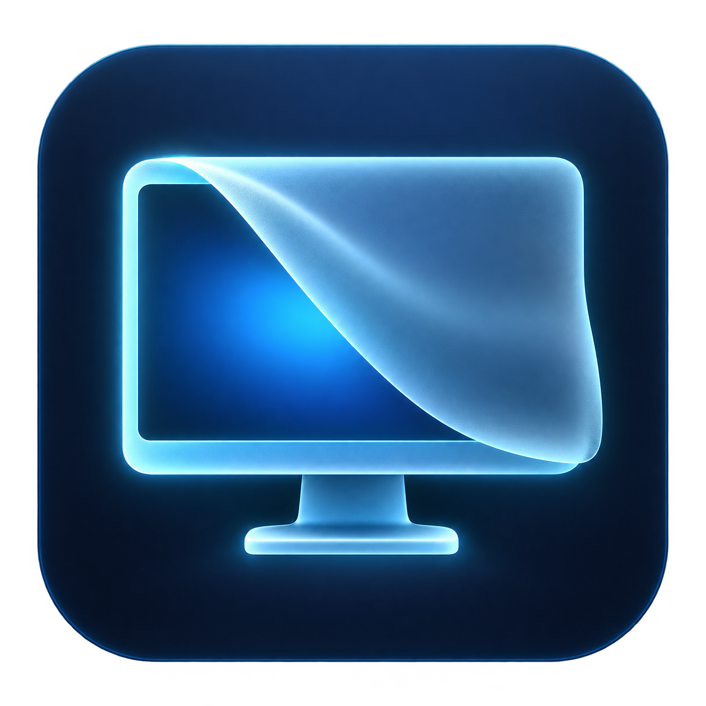

# AirShade

<p align="center"></p>

**Look away. Your screen follows.**

A local macOS 14+ menu bar privacy app. Compatible AirPods provide head orientation; looking away progressively covers every display with a blurred in-memory snapshot. Returning to center clears it. Disconnects, two-second motion gaps, and sleep/wake require explicit recalibration before revealing the screen.

## Requirements

- macOS 14 or later, compatible motion-capable AirPods, and Xcode with command-line tools.
- Motion permission; Screen Recording permission enables blur (otherwise the cover is opaque).
- This is an early beta source release. No notarized download is provided yet.

## Build from source

Clone this repository, change into its directory, then run:

```sh
./script/build_and_run.sh
```

The script builds with the installed Xcode toolchain, stages a locally signed app (using an available Apple Development certificate, or ad-hoc signing as a fallback), and opens it. `AirShade.xcodeproj` also builds directly in Xcode (scheme **AirShade**). No dependencies are downloaded.

Supported families: AirPods 3 and newer (including AirPods 4), all AirPods Pro generations, and AirPods Max. There is no model whitelist: other headphones work if Apple exposes compatible headphone motion. AirPods 1/2 cannot provide this feature. Live samples, not the marketing name, determine readiness.

1. Connect compatible AirPods to **this Mac**, wear them, and select **Allow motion & connect**.
2. Approve Motion access. Grant Screen Recording in setup for blur; restart AirShade if macOS requests it. Without capture access, the shield is opaque.
3. Under **Your screens & comfort zone**, choose one screen or a second screen on the left/right. AirShade initially suggests a side from macOS display positions.
4. For two screens, select **Capture main screen**, look at its center during the three-second countdown, then select **Capture left/right screen** and look at that display during its countdown. Protection pauses during setup. The measured spacing and sensor direction are saved. You can also adjust the angle slider manually.
5. Look back at your **main screen** and select **Calibrate & enable** once live samples arrive. The whole horizontal sweep between the two screens stays clear, plus your comfort margin on each outer edge.
6. Adjust the comfort zone (15° default), transition span (additional 18°), and blur strength if desired.

Controls are available in the menu bar and on the shield:

- **Control–Option–Command–P:** enable or pause. Pausing explicitly reveals the display.
- **Control–Option–Command–C:** recenter/resume using a fresh sample.
- After disconnect, stale motion, or waking: look forward and explicitly resume. A reconnect alone never clears the shield.

Launch at login is opt-in. Each new app process starts **paused**, so calibrate before relying on it. Keep the app at a stable path when using login launch. The build script uses an available Apple Development identity to preserve permission identity across rebuilds. For Xcode, copy `Config/Signing.local.xcconfig.example` to `Config/Signing.local.xcconfig` and enter your own team ID; that local file is ignored. Without it, Xcode uses ad-hoc signing. Set `AIRSHADE_SIGNING_IDENTITY` to override the script identity. On Macs without a development identity the script falls back to ad-hoc signing, which can require permission again after rebuilding. The first transition from ad-hoc to certificate signing may require turning AirShade off and on in Screen Recording settings, then reopening it. This build is for personal use, not notarized distribution.

## Development

```sh
./script/build_and_run.sh --build       # package only
./script/build_and_run.sh --verify      # launch and confirm process
./script/build_and_run.sh --simulate    # explicit simulated-headphone UI
./script/build_and_run.sh --debug       # LLDB
./script/build_and_run.sh --logs        # unified process logs
./script/test.sh
```

In simulation, connect, calibrate at zero, then move the yaw/pitch sliders. The cover's Recenter/Resume or Pause controls recover visibility. Unchecking **Send motion samples** exercises the two-second watchdog. Simulation never silently replaces real hardware.

The Swift package separates `AirShadeCore` (pure state machine) from platform services. Xcode compiles the same sources into the app. `MotionProviding` supplies timestamped yaw/pitch and loss events; `AppModel` owns shared state; `OverlayService` owns per-display windows and capture lifetime. SwiftUI owns setup/preferences; AppKit provides display-sized, all-Spaces panels and global shortcut integration.

## Privacy and limits

- No network service, analytics, camera, microphone, screenshot files, or background screen-capture stream.
- Capture is requested once when a cover begins, excluding AirShade windows. The snapshot is blurred and retained in memory only until the shield clears. Newly added/reconfigured displays get a new snapshot. Capture failure leaves an opaque cover.
- Head pose is not physical presence: walking straight away while remaining connected, or leaving headphones at the desk, may not trigger protection. Earbud removal and automatic audio switching depend on the hardware's motion delivery behavior.
- This is a visual aid, **not a security lock**. It cannot guarantee protection in Mission Control, privileged system surfaces, remote capture/sharing, app crashes, or after you quit. Use macOS Lock Screen when security is required.
- Two-screen mode accepts the full horizontal sweep between the calibrated main and side displays. Vertical tolerance still uses the main screen. Use the main screen whenever enabling, recentering, or recovering after disconnect. Recalibrate the pair if you move the screens.
- The live vector diagram shows your screens, the green clear zone, orange transition bands, gray full-cover zone, and head direction while tracking. It updates immediately with configuration sliders. A wider clear zone trades earlier covering for more freedom of movement.
- Apple Watch support is deferred.

## Validation status

15 automated state-machine tests pass. The app has been built and used on an Apple Silicon Mac, including AirPods 4 and a two-screen setup. Broader hardware testing, extended battery measurements, Intel validation, and distribution notarization remain outstanding.

## Contributing

Bug reports and improvements are welcome. Include your macOS version, AirPods model, display layout, and steps to reproduce. Do not attach credentials or screenshots containing private information. Run `./script/test.sh` before submitting code changes.

## License

MIT — see [LICENSE](LICENSE).
